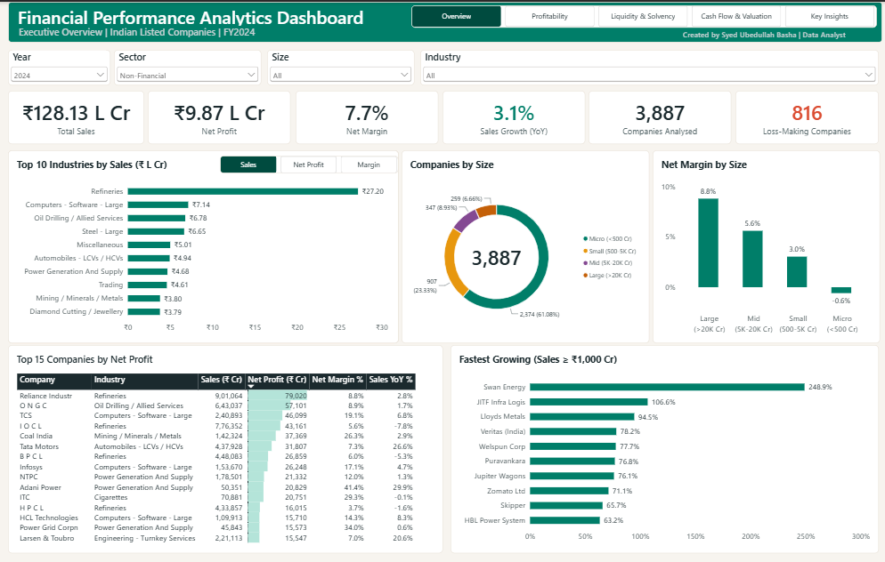
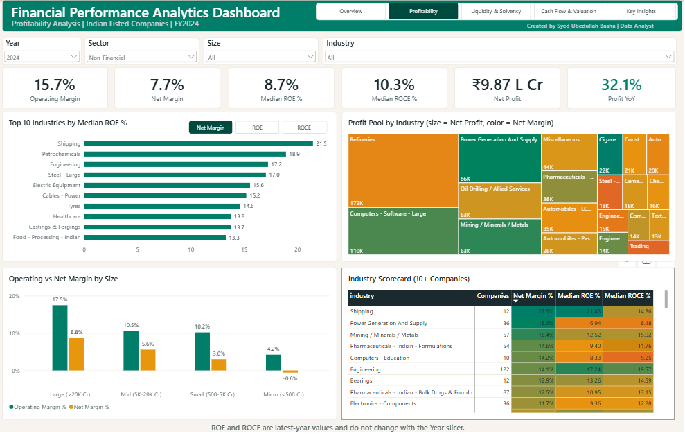
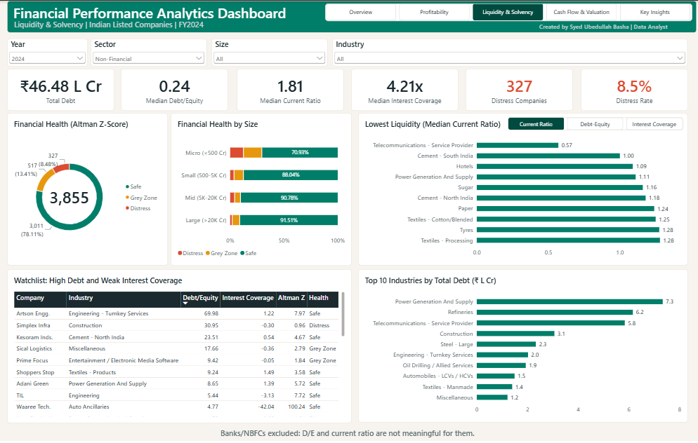
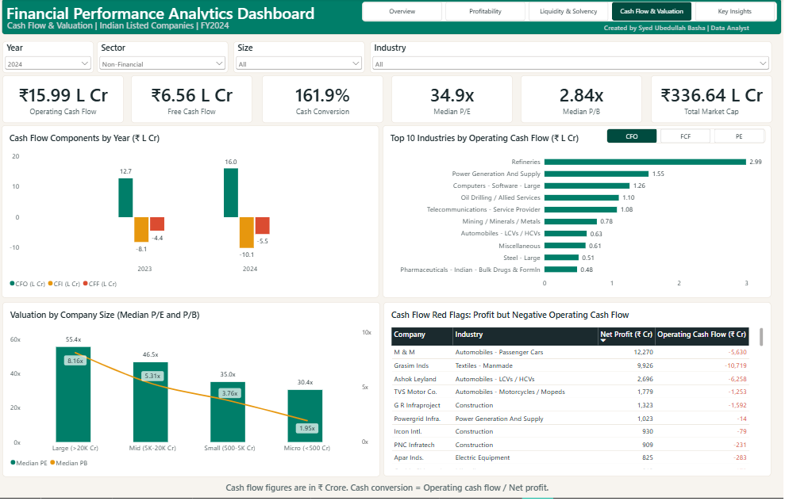
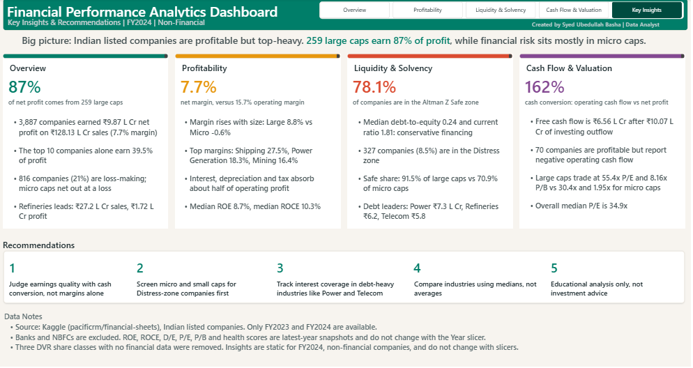
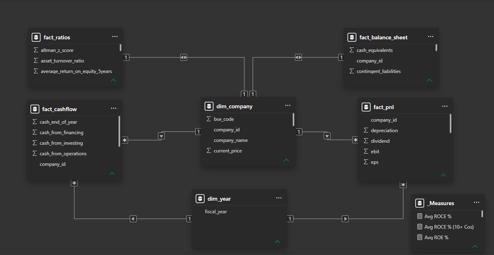

# Financial Performance Analytics Dashboard

**Profitability, liquidity, cash flow and valuation analysis of Indian listed companies (FY2024)**


An end-to-end analytics project: raw Kaggle CSVs are cleaned and reshaped in **Python**, modelled and queried in **SQL Server**, and presented as a five-page interactive **Power BI** dashboard with written insights and recommendations.



---

## Key numbers (FY2024, non-financial companies)

| Metric | Value |
|---|---|
| Companies analysed | 3,887 |
| Total sales | ₹128.13 L Cr |
| Net profit | ₹9.87 L Cr |
| Net margin | 7.7% |
| Like-for-like sales growth | 3.1% |
| Loss-making companies | 816 (21%) |

*1 Lakh Crore (L Cr) = 100,000 Crore.*

## Business questions

1. How profitable are Indian listed companies, and which industries lead?
2. How concentrated are profits across company sizes?
3. How strong are balance sheets: leverage, liquidity, interest coverage?
4. Which companies show financial distress or high-leverage risk?
5. Do reported profits convert into cash?
6. How are companies valued relative to their size and returns?

## Key findings

- **Profits are concentrated.** The top 10 companies earn 39.5% of net profit; 259 large caps (market cap above ₹20K Cr) earn 87%.
- **Profitability rises with size.** Net margin is 8.8% for large caps and -0.6% for micro caps.
- **Balance sheets are conservative at the median** (debt-to-equity 0.24, current ratio 1.81). By Altman Z-score, 78.1% of companies are Safe and 8.5% are in Distress; 70.9% of micro caps are Safe versus 91.5% of large caps.
- **Cash generation is strong.** Operating cash flow (₹15.99 L Cr) is 162% of net profit, yet 70 profitable companies report negative operating cash flow.
- **Valuations rise with size.** Large caps trade at a median 55.4x P/E and 8.16x P/B versus 30.4x and 1.95x for micro caps.

## Dashboard pages

| Page | Focus |
|---|---|
| 01 Overview | KPIs, top industries (Sales / Net Profit / Margin toggle), company mix, top 15 companies, fastest growing |
| 02 Profitability | Margins, median ROE and ROCE, profit-pool treemap, industry scorecard heat map |
| 03 Liquidity & Solvency | Debt, current ratio, interest coverage, Altman Z health, high-debt watchlist |
| 04 Cash Flow & Valuation | Operating and free cash flow, cash conversion, P/E and P/B by size, cash-flow red flags |
| 05 Key Insights | One-page summary of findings and recommendations |






## Workflow

```
Kaggle CSVs (11 files)  ->  Python (clean, reshape)  ->  SQL Server (schema, queries, views)  ->  Power BI (model, DAX, visuals)
```

| Stage | What was done |
|---|---|
| **Python** | Wide-to-long reshape, derived metrics (margins, interest coverage, net worth, Altman Z health, size bucket, financial-sector flag), data-quality report, SQL-ready CSVs |
| **SQL Server** | 5 typed tables with primary and foreign keys, row-count validation, 9 analysis queries (LAG, RANK, ROW_NUMBER, CTEs), 3 views |
| **Power BI** | Star schema, 40+ DAX measures, custom Emerald and Graphite theme, page navigator, synced slicers, bookmark toggle buttons, conditional formatting |

## Data model



`dim_company` is the centre of the model. `fact_pnl` and `fact_cashflow` are many-to-one to it and also relate to `dim_year`. `fact_balance_sheet` and `fact_ratios` are latest-year snapshots with one row per company.

## Data

- **Source:** Kaggle dataset [pacificrm/financial-sheets](https://www.kaggle.com/datasets/pacificrm/financial-sheets), Indian listed companies on BSE and NSE. The raw CSVs are not included in this repository; see `data/README.md`.
- **Scale:** 4,668 companies, 107 industries; 8 of the 11 CSV files are used.
- **Period:** FY2024 and FY2023 only (the file holds two annual periods).

## Design decisions worth noting

- **Top-N before filters.** A "top 10 industries by margin, with at least 5 companies" chart showed only 5 bars, because the Top-N ran before the company-count filter. The threshold was moved inside the measure, so ineligible industries return blank and are never ranked.
- **Medians over averages.** ROE ranges from -3,559% to 13,100% across companies, so industry comparisons use medians.
- **Unit consistency.** ROE and ROCE are stored as percentage numbers while margins are fractions; each measure has its own format string.
- **Financial sector handled separately.** Banks and NBFCs (628 companies) are flagged and excluded from leverage and liquidity ratios.

## Repository structure

```
financial-performance-analytics-dashboard/
├── README.md
├── LICENSE
├── .gitignore
├── data/
│   └── README.md                 (dataset source and file list; raw CSVs not included)
├── python/
│   └── 01_clean_and_reshape.py
├── sql/
│   ├── 02_create_tables_and_load.sql
│   └── 03_analysis_queries_and_views.sql
├── powerbi/
│   └── Financial_Performance_Analytics_Dashboard.pbix
├── report/
│   └── Financial_Performance_Analytics_Report.pdf
└── screenshots/
    ├── 01_Overview.png
    ├── 02_Profitability.png
    ├── 03_Liquidity_Solvency.png
    ├── 04_CashFlow_Valuation.png
    ├── 05_Key_Insights.png
    └── 06_Data_Model.png
```

## How to reproduce

1. Download the dataset from Kaggle (see `data/README.md`) and unzip the 11 CSV files into `data/raw/`.
2. Set `IN_DIR` in `python/01_clean_and_reshape.py` to the folder with the CSVs and run `python python/01_clean_and_reshape.py`. It writes five clean CSVs and a data-quality report.
3. Run `sql/02_create_tables_and_load.sql` in SQL Server Management Studio (update the file paths in `BULK INSERT`, or use the Import Wizard) and confirm the row counts: 4,668 / 9,330 / 9,330 / 4,668 / 4,668.
4. Run `sql/03_analysis_queries_and_views.sql` to explore the analysis and create the views.
5. Open `powerbi/Financial_Performance_Analytics_Dashboard.pbix`, point the data source to your SQL Server database, refresh, and set **Year = 2024** and **Sector = Non-Financial**.

## Limitations

- Only two annual periods (FY2023, FY2024) are available, so multi-year trends are not covered.
- ROE, ROCE, debt-to-equity, P/E, P/B and health scores are latest-year snapshots and do not change with the Year slicer.
- Written insights on Page 5 are static and calculated for FY2024, non-financial companies.
- Figures come from a public Kaggle dataset and were not independently verified against company filings.
- This is an educational analysis, not investment advice.

## Full report

A 13-page write-up with methodology, data-quality decisions and page-by-page insights: [`report/Financial_Performance_Analytics_Report.pdf`](report/Financial_Performance_Analytics_Report.pdf)

## License

Code and report are released under the [MIT License](LICENSE). The dataset belongs to its original author and is subject to its own Kaggle license.

## Author

**Syed Ubedullah Basha**: Data Analyst | Power BI Developer | SQL Developer

[LinkedIn](https://www.linkedin.com/in/syed-ubedullah-basha) | [GitHub](https://github.com/syed-ubedullah) | syedubedullahbasha@gmail.com
